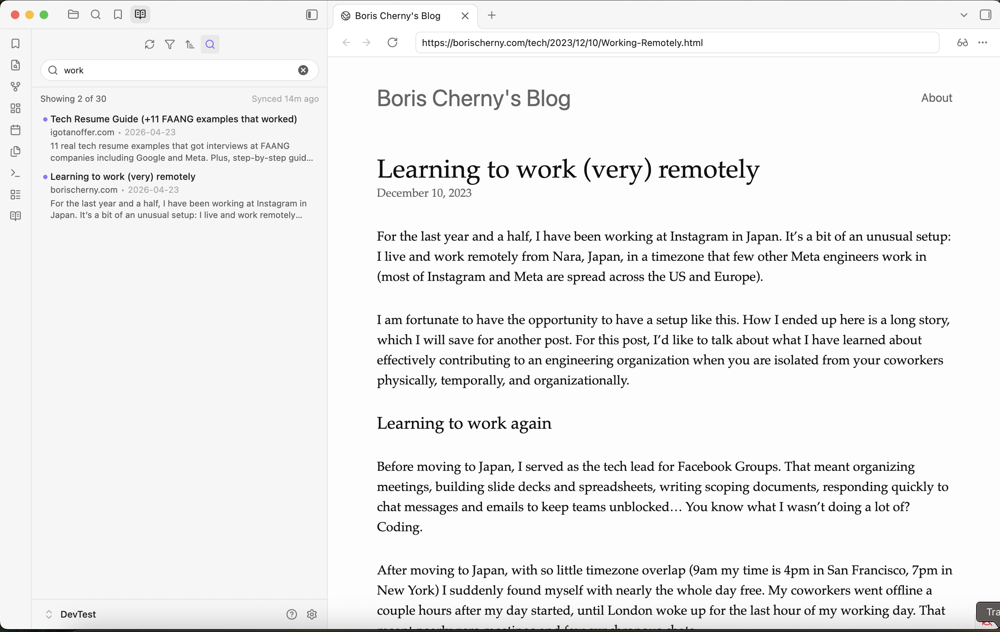

# Reading List for Obsidian

Import your browser reading list as individual Markdown notes into your Obsidian vault, using your own customizable template.



## Features

- **Multi-browser support**: Import reading lists from Google Chrome, Chromium (Brave, Edge, etc.), Safari (macOS), or Mozilla Firefox (via a bookmark folder).
- **Customizable templates**: A template is a markdown file in the plugin's `templates` folder, bundled into the build with its file name as the template name. Editing a template in settings switches the selection to **Custom** and leaves the built-in file untouched. Templates use placeholders like `{{title}}`, `{{url}}`, `{{date}}`, `{{excerpt}}`, `{{read}}`, and more.
- **Frontmatter ready**: Use filters like `{{title|yaml}}` to safely format text for YAML frontmatter.
- **Article previews**: Include the browser's excerpt (`{{excerpt}}`) and read state (`{{read}}`) when the browser records them.
- **Safe duplicate handling**: URL-based indexing ensures each URL produces a single note.
- **Flexible automation**: Sync manually on demand, automatically on startup, or at periodic intervals.
- **Conflict-free updates**: Uses atomic vault updates so notes are modified safely without race conditions.

## Installation

### Community plugins (Recommended)

Install directly from the [Obsidian community plugins](https://community.obsidian.md/plugins/reading-list) store:

1. Open Obsidian **Settings** → **Community plugins**.
2. Select **Browse** and search for **Reading List**.
3. Select **Install**, then select **Enable**.
4. Open **Settings** → **Reading List** to configure the plugin.

### Manual installation

1. Download the latest release (`main.js`, `manifest.json`, `styles.css`) from the [Releases](https://github.com/chadidi/obsidian-reading-list/releases) page.
2. Create a folder named `reading-list` in your vault's plugin directory: `<vault>/.obsidian/plugins/reading-list/`.
3. Copy `main.js`, `manifest.json`, and `styles.css` into that folder.
4. Reload Obsidian and enable the plugin under **Settings** → **Community plugins**.

### Build from source

```bash
git clone https://github.com/chadidi/obsidian-reading-list.git
cd obsidian-reading-list
npm install
npm run build
```

Copy `main.js`, `manifest.json`, and `styles.css` into `<vault>/.obsidian/plugins/reading-list/`.

## First run

1. Go to **Settings** → **Reading List**.
2. Select your browser under **Source**. The plugin will automatically detect your browser's default reading list file on macOS, Windows, or Linux.
3. Choose your target vault folder and template.
4. Click **Sync reading list now** (or click the ribbon icon, or run the command `Sync now`).
5. Automatic syncs (on startup or periodic) are kept disabled until one manual sync has completed successfully to prevent accidental imports.

## Supported browsers

| Browser | Default file location | Notes |
|---|---|---|
| **Google Chrome** | `…/Google/Chrome/Default/Reading List` (macOS / Windows / Linux) | JSON file named `Reading List` (no extension) with a top-level `reading_list` array. Custom profiles, or other Chromium-based browsers (e.g. Brave, Edge, Arc), can be used by providing their custom path in settings. |
| **Chromium** | `…/Chromium/Default/Reading List` (macOS / Windows / Linux) | Same JSON layout as Chrome. Detect the default Chromium profile automatically, or set a custom profile path in settings. |
| **Safari** | `~/Library/Safari/Bookmarks.plist` (macOS) | Binary plist, parsed directly in-process. Safari keeps its Reading List inside this file under a synthetic `com.apple.ReadingList` folder, which the plugin reads while ignoring regular bookmarks. Because macOS protects `~/Library/Safari/`, either use **Choose Bookmarks.plist** in settings to grant read access to just that file for the session (no Full Disk Access needed), or grant Obsidian **Full Disk Access** in macOS **System Settings** → **Privacy & Security**. Safari records an article excerpt but no read state, and no creation dates, so `{{date}}` uses the sync date. |
| **Firefox** | Auto-detected `places.sqlite` or `bookmarkbackups/*.jsonlz4` | Firefox has no native reading list, so the plugin reads the bookmarks inside a folder you name (matched by name anywhere in the tree). It reads live bookmarks from `places.sqlite` with the SQLite module built into Obsidian, on a temporary copy taken together with its `-wal` file so uncheckpointed changes are included. Alternatively, point to a `bookmarkbackups/*.jsonlz4` file or directory for native decompression. |

## Template placeholders

| Placeholder | Description |
|---|---|
| `{{title}}` | Item title (falls back to host/path if title is empty). |
| `{{url}}` | Full URL of the item. |
| `{{date}}` | Date the item was added to the reading list (supports moment.js format, e.g. `{{date:YYYY-MM-DD}}`). |
| `{{synced}}` | Date the current sync occurred (e.g. `{{synced:YYYY-MM-DD HH:mm}}`). |
| `{{excerpt}}` | Article preview text recorded by the browser (Safari), empty when none is available. |
| `{{read}}` | Read state when the browser tracks it (Chrome): `true` or `false`. Empty when the browser does not track it. |
| `{{domain}}` | Clean domain name without `www.` (e.g. `obsidian.md`). |
| `{{browser}}` | Browser name (e.g. `Google Chrome`, `Chromium`, `Safari`, `Firefox`). |

### Filters

You can apply pipe filters to any placeholder:

- `|yaml`: Safely quotes and escapes values for YAML frontmatter (e.g. `title: {{title|yaml}}`).
- `|lower`: Converts value to lowercase.
- `|upper`: Converts value to uppercase.
- `|slug`: Converts value to a URL-friendly slug (e.g. `{{title|slug}}`).

## Sync behavior

- **One-way sync**: Notes are always overwritten with the latest template render, so template changes apply on the next sync.
- **Renaming and moving notes**: The plugin tracks notes by their URL mapping in `data.json`. Renaming or moving notes inside Obsidian will preserve the association.
- **Deleting notes**: If you delete an item's note in Obsidian, it will be treated as new on the next sync and recreated.
- **Removing deleted items**: If you remove an item from your browser's reading list, its note is deleted from the vault on the next sync. Only notes the plugin created (tracked in `data.json`) are removed; notes for items that still exist in the browser but fall outside the configured source are left untouched.

## Disclosures & privacy

- **Desktop only**: This plugin requires Obsidian's desktop application (macOS, Windows, or Linux) because it uses local filesystem access to read browser data files.
- **Filesystem access outside vault**: This plugin reads local browser files stored on your computer (such as `Bookmarks.plist` for Safari, the `Reading List` file for Chrome/Chromium, or `places.sqlite` for Firefox). These files are read strictly to import your reading list. When you pick a Safari `Bookmarks.plist` through the native file dialog, its contents are held in memory for the current session only and are never written to disk or persisted in settings.
- **100% offline & private**: No network requests are made. No analytics or telemetry are collected. All reading-list processing and note generation happens completely locally on your device.

## License

[MIT](LICENSE) © [Abdellah Chadidi](https://github.com/chadidi)
